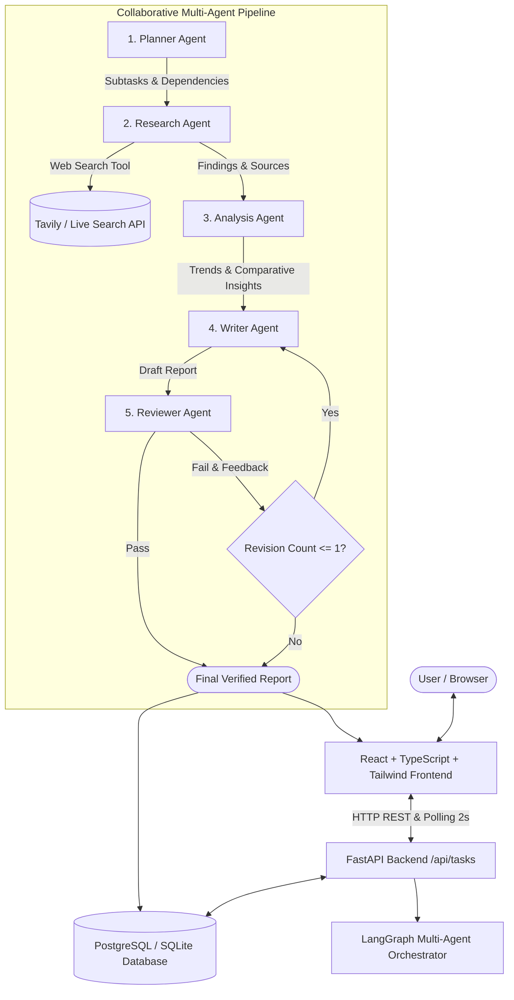

# Agentic AI Research & Task Execution System

An end-to-end full-stack agentic research platform built with **FastAPI**, **LangGraph**, **PostgreSQL / SQLite**, and **React + TypeScript + Vite + Tailwind CSS**.

The system accepts natural language research objectives, plans subtasks, routes work through specialized collaborative agents, executes real-time web searches, analyzes evidence, authors structured Markdown reports, and enforces a deterministic **reflection loop** via a lead reviewer agent before final output delivery.

---

## Architecture Overview



---

## 1. Five Specialized Agents

| Agent | Core Responsibility | Input → Output |
| :--- | :--- | :--- |
| **Planner Agent** | Understands the research objective; decomposes into actionable subtasks with dependency tracking. | `User Request` → `Structured Plan (Subtasks)` |
| **Research Agent** | Formulates targeted queries and calls the live web-search tool to retrieve grounded evidence. | `Subtasks` → `Findings, URLs, Snippets` |
| **Analysis Agent** | Synthesizes findings, identifies ecosystem trends, compares approaches, and assesses risks. | `Research Findings` → `Comparative Insights & Risks` |
| **Writer Agent** | Produces publication-grade, structured Markdown research reports with verified citations. | `Plan + Findings + Analysis` → `Markdown Draft` |
| **Reviewer Agent** | Audits draft against user objective for completeness, consistency, grounding, and depth. | `Draft + Request` → `Pass/Fail Verdict + Feedback` |

### Deterministic Reflection Rule
If the Reviewer Agent rejects the draft on its initial evaluation, the critique is routed directly back to the Writer Agent. The Writer revises the report to incorporate all feedback, followed by a second verification pass. The system caps `revision_count` at **1** to prevent infinite loops and ensure predictable latency.

---

## 2. Technology Stack

- **Frontend**: React 19, TypeScript, Vite, Tailwind CSS v4, Lucide Icons, React Markdown.
- **Backend**: Python 3.11+, FastAPI, Pydantic v2, SQLAlchemy 2.0, Uvicorn.
- **Multi-Agent Orchestration**: LangGraph, LangChain Core.
- **Search Tool**: Tavily API with built-in live open search fallback.
- **Database**: PostgreSQL (Production on Render) / SQLite (Zero-config local development).
- **Hosting**: Render (FastAPI + Postgres) & Vercel (React Frontend).

---

## 3. Repository Structure

```text
agentic-ai-research/
├── backend/
│   ├── app/
│   │   ├── main.py              # FastAPI app, CORS, lifespan, /health
│   │   ├── api/tasks.py         # REST endpoints for task submission, polling, history
│   │   ├── agents/              # Planner, Researcher, Analyst, Writer, Reviewer
│   │   ├── orchestration/       # LangGraph state machine & conditional edges
│   │   ├── tools/web_search.py  # Web search tool (Tavily + open search fallback)
│   │   ├── models/schemas.py    # Pydantic v2 request/response schemas
│   │   ├── services/task_service.py # Orchestrator, live event logger, state persistence
│   │   ├── db/database.py       # SQLAlchemy models for Tasks and Events
│   │   └── core/config.py       # Pydantic BaseSettings environment configuration
│   ├── tests/                   # Pytest API and multi-agent test suite
│   ├── requirements.txt         # Pinned backend dependencies
│   └── .env.example             # Configuration variables
├── frontend/
│   ├── src/
│   │   ├── components/          # Navbar, TaskInput, ExecutionMonitor, FinalReport, HistorySidebar
│   │   ├── services/api.ts      # Typed API client
│   │   ├── types/index.ts       # Shared TypeScript models
│   │   ├── App.tsx              # Application shell with 2s polling & refresh persistence
│   │   └── index.css            # Tailwind CSS styling tokens
│   ├── package.json             # Frontend dependencies
│   ├── vite.config.ts           # Vite bundler & API proxy configuration
│   └── vercel.json              # Vercel deployment configuration
├── render.yaml                  # Render Infrastructure as Code Blueprint
├── Dockerfile                   # Backend container specification
├── docker-compose.yml           # Local multi-service Postgres + Backend setup
└── README.md
```

---

## 4. Backend API Contract

| Method | Endpoint | Description |
| :--- | :--- | :--- |
| `POST` | `/api/tasks` | Submit new research task & trigger multi-agent pipeline in background |
| `GET` | `/api/tasks/{id}` | Retrieve task status, plan, intermediate findings, and report |
| `GET` | `/api/tasks/{id}/plan` | Retrieve decomposed subtasks generated by Planner Agent |
| `GET` | `/api/tasks/{id}/events` | Real-time agent event stream (for UI polling every 2s) |
| `GET` | `/api/tasks/{id}/result` | Final reviewed Markdown report, citations, and reviewer verdict |
| `GET` | `/api/tasks` | List previous research tasks from persistent database |
| `GET` | `/health` | Production health check & database connectivity status |

### Task Status Lifecycle
`queued` ➔ `planning` ➔ `researching` ➔ `analyzing` ➔ `writing` ➔ `reviewing` ➔ `completed` *(or `failed`)*

---

## 5. Local Setup & Quickstart

### Prerequisites
- Python 3.11+
- Node.js 18+ and npm

### Backend Setup
```bash
# 1. Navigate to backend
cd backend

# 2. Create virtual environment
python -m venv .venv

# 3. Activate virtual environment
# Windows:
.venv\Scripts\activate
# Linux/macOS:
source .venv/bin/activate

# 4. Install dependencies
pip install -r requirements.txt

# 5. Configure environment variables (optional)
cp .env.example .env

# 6. Run automated tests
pytest tests

# 7. Start FastAPI development server
uvicorn app.main:app --reload --port 8000
```
API Documentation will be live at: `http://localhost:8000/docs`

### Frontend Setup
```bash
# 1. Navigate to frontend
cd frontend

# 2. Install dependencies
npm install

# 3. Start Vite dev server
npm run dev
```
Frontend will be live at: `http://localhost:5173`

---

## 6. Running with Docker Compose

To run both the PostgreSQL database and FastAPI backend in Docker:
```bash
docker-compose up --build
```

---

## 7. Public Deployment

### Backend (Render)
1. Fork or push this repository to GitHub.
2. In Render, select **Blueprints** and connect the repository (using `render.yaml`).
3. Render automatically provisions the managed PostgreSQL database and FastAPI web service.
4. Verify `/health` responds with `{"status": "healthy"}`.

### Frontend (Vercel)
1. In Vercel, click **Add New Project** and import the repository.
2. Set Root Directory to `frontend`.
3. Set Environment Variable:
   - `VITE_API_BASE_URL`: `https://<your-render-backend-url>.onrender.com`
4. Deploy.

---

## 8. Verification & Acceptance Testing

Run backend tests:
```bash
pytest backend/tests
```
Tests verify:
- ✅ **Planner Agent**: Proper goal decomposition into ordered subtasks.
- ✅ **Research Agent**: Live tool query generation and source aggregation.
- ✅ **Reviewer Reflection Cap**: Verifies that rejection triggers revision and that revision count is capped at 1.
- ✅ **Writer Agent**: Complete Markdown authoring with grounded citations.
- ✅ **FastAPI Contract**: All routes (`/health`, `POST /api/tasks`, `GET /api/tasks/{id}`, `GET /api/tasks/{id}/events`) function with schema validation.
